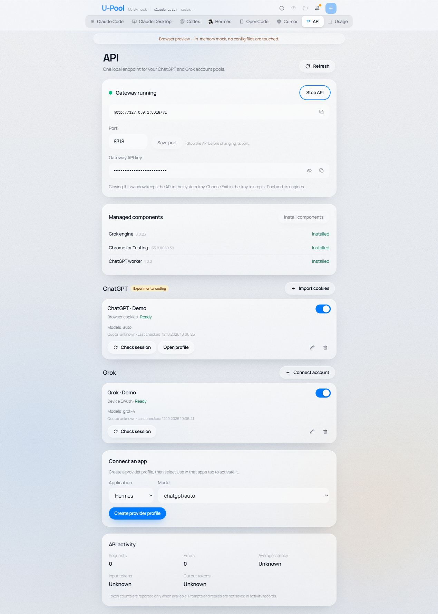

# U-Pool

**Your AI coding tools, accounts and local API in one desktop app.**

Switch providers for Claude Code, Codex, Hermes and OpenCode, manage Cursor accounts, and track local token usage. New in **1.0.0**: connect ChatGPT and Grok accounts to a managed API pool with one local endpoint.

<p align="center">
  <a href="https://github.com/U-C4N/U-Pool/releases/latest"></a>
  
  
  <a href="https://github.com/U-C4N/U-Pool/stargazers"></a>
</p>

<p align="center">
  <a href="https://github.com/U-C4N/U-Pool/releases/latest"><strong>Download</strong></a> ·
  <a href="#whats-new-in-100">What's new</a> ·
  <a href="docs/api-gateway.md">API guide</a> ·
  <a href="#run-from-source">Build from source</a>
</p>

<p align="center">
  
  <br />
  <sub>The 1.0.0 API workspace. Captured from the current UI's browser preview with demo accounts; no real credentials or live account activity are shown.</sub>
</p>

> **Version status:** this source tree is 1.0.0. Its [validation record](docs/v1-validation.md) still lists release gates, so the download page may offer an earlier published version. ChatGPT coding support is experimental; see [API compatibility](#api-compatibility) before connecting a client.

## What's new in 1.0.0

- **One local API:** ChatGPT cookie sessions and Grok device OAuth accounts behind `http://127.0.0.1:8318/v1`, protected by a single client key.
- **Managed components:** install the pinned browser and API engines from the app. Each account has its own profile, session checks and recovery controls.
- **Account routing:** ready accounts serve requests automatically; expired sessions and quota cooldowns are tracked separately.
- **Client profiles:** create a provider for Hermes, OpenCode or Codex from the API tab, then activate it in the corresponding app tab. Compatibility varies by client.
- **API activity:** inspect request counts, errors, latency and reported tokens. Prompt and response contents are not stored in the activity database.
- **Windows tray:** keep the gateway running when the window closes; reopen, start/stop the API or quit from the tray.

## Get started

1. Download the Windows ZIP from the [latest published release](https://github.com/U-C4N/U-Pool/releases/latest).
2. Extract it to a folder you can write to, outside `Program Files`, so in-app updates can replace the app.
3. Run **U-Pool.exe**. The packaged application does not require a separate Python, Node.js or Docker installation.
4. Choose a tool tab to add or switch a provider, or open **API** to set up the new account pool.

Provider configuration, the Cursor pool and local usage are available from source across platforms. The managed API pool requires **Windows x64**. Registry integration, launch at sign-in, the tray and in-app updates are Windows-only.

## What you can manage

| Workspace | What it does |
| --- | --- |
| Claude Code | Switch endpoints, keys, models and supported permission options |
| Codex | Manage providers, authentication, model selection and approval/sandbox settings |
| Hermes | Configure providers, transport and models in its YAML configuration |
| OpenCode | Configure provider endpoints, SDK adapters and models |
| Claude Desktop | Save and test provider profiles; configuration writing is still preview-only |
| Cursor | Keep account sessions, inspect plan/usage and activate eligible desktop sessions |
| API | Pool ChatGPT and Grok accounts behind a local gateway |
| Usage | Read Claude Code and Codex transcripts for daily, model and project token/cost summaries |

Provider tabs include presets for official APIs and compatible services, endpoint reachability checks, and an official mode that clears U-Pool's managed overrides. A switch changes the configuration fields U-Pool owns; unrelated settings are preserved. Writes are atomic and backups are enabled by default.

Usage prices are estimates and can be edited in **Settings → Pricing**. Models without prices still show tokens. The saved usage snapshot survives deletion of transcripts it has already read.

### Switch a provider

Choose an app, add a preset or custom provider, enter its endpoint/key/model, and select the provider to activate it. On Windows, U-Pool also updates the environment variables used by Claude Code and Codex. Restart an already-open client or terminal to pick up environment changes.

### Manage Cursor accounts

Import cookies or keep the session from an account already signed into Cursor. Cards show identity, plan, usage and session status. **Browser cookies can display account usage but cannot activate the desktop app**; switching requires a desktop session token. U-Pool closes a running Cursor before changing its authentication records and reopens it afterwards.

Live switching between two different Cursor accounts remains unverified. Read the [Cursor notes and backup behavior](docs/configuration.md#the-cursor-pool) before using this workflow.

## Set up the API pool

1. Open **API → Install components** and wait for the managed runtimes.
2. Choose **Import cookies** for ChatGPT or **Connect account** for Grok. Wait until the account is verified and its models are available.
3. Select **Start API**. Copy the endpoint, gateway key and an available model ID.
4. Use them in a compatible client, or select an application/model under **Connect an app** and create its provider profile.

| Client setting | Value |
| --- | --- |
| Base URL | `http://127.0.0.1:8318/v1` by default |
| API key | Copy the gateway key from the API tab |
| Model | Copy an available `chatgpt/...` or `grok/...` identifier from the pool |
| Endpoints | `GET /v1/models`, `POST /v1/chat/completions`, `POST /v1/responses` |

Closing the window leaves U-Pool in the Windows tray. Use the tray's **Quit** action to stop the application and its managed processes.

### API compatibility

- **ChatGPT tools are experimental.** Web responses are adapted into validated tool calls; the gateway does not execute those tools. SSE is supported, but a completed answer may arrive as one content chunk.
- **Responses is stateless.** Clients must send the full conversation. Stateful responses, built-in tools, multimodal input and WebSocket transport are outside v1.
- **Codex CLI 0.161.0 is currently incompatible** with the gateway's strict Responses contract. Creating its profile does not establish working generation. This limitation concerns the managed API, not ordinary Codex provider switching.
- **Live acceptance is incomplete.** ChatGPT SDK/tool-call checks passed; coding-client acceptance, real Grok generation, live multi-account routing and clean-machine validation remain pending.

See the [API setup guide](docs/api-gateway.md) for supported controls, Hermes settings, session recovery and a request example. The [validation record](docs/v1-validation.md) separates tested behavior from remaining release checks.

## Run from source

Requires **Python 3.11+** and **Node.js 20.9+** for the UI build.

```powershell
git clone https://github.com/U-C4N/U-Pool.git
cd U-Pool
python -m pip install -e ".[dev]"
npm --prefix ui ci
npm --prefix ui run build
python -m upool
```

`python -m upool --version` prints the version; `--debug` opens the webview developer tools. Source users also need `python scripts/prepare_proxy_runtimes.py` before installing the API components.

<details>
<summary>Develop and test</summary>

Run the UI in one terminal:

```powershell
npm --prefix ui run dev
```

Open the local URL printed by Next.js for an in-memory browser preview, or connect the desktop shell from a second terminal:

```powershell
$env:UPOOL_DEV_URL = "http://localhost:3000"
python -m upool
```

Run the checks:

```powershell
python -m pytest --basetemp=.pytest-tmp -p no:cacheprovider
npm --prefix ui run typecheck
npm --prefix ui run build
```

Tests redirect app state, configuration targets and registry writes into a sandbox. For manual backend probes, use `python scripts/sandbox.py your_probe.py`; running write paths directly can change your real coding-tool configuration. See [CLAUDE.md](CLAUDE.md).

</details>

<details>
<summary>Build the Windows x64 package</summary>

```powershell
python scripts/build.py
# Reuse an existing UI export and checksum-verified API worker:
python scripts/build.py --skip-ui --reuse-proxy-worker
```

Outputs: `dist/U-Pool/U-Pool.exe`, `dist/U-Pool-1.0.0-win64.zip` and `dist/SHA256SUMS.txt`. The build prepares an isolated API worker, includes license notices, and smoke-tests the executable. Browser/engine downloads use pinned versions and verified hashes.

Complete the [release checks](docs/v1-validation.md#remaining-release-gates) before publishing. Attach the ZIP and checksum file to a GitHub release tagged `vX.Y.Z` for the in-app updater.

</details>

## Documentation

| Guide | Contents |
| --- | --- |
| [API setup and limits](docs/api-gateway.md) | Account setup, requests, client compatibility, recovery and live validation |
| [Configuration and account switching](docs/configuration.md) | Files and registry keys, backups, Cursor behavior and per-app details |
| [1.0.0 validation](docs/v1-validation.md) | Automated checks, packaged tests and outstanding release gates |
| [Design notes](docs/superpowers/specs/) | Feature designs and implementation context |
| [Third-party notices](THIRD_PARTY_LICENSES.txt) | Managed components and dependency provenance |

Built with **Python + pywebview**, **Next.js + React + Tailwind**, and **PyInstaller**. The UI is exported as static files inside a native OS webview; no Electron or Node.js runtime is needed in the packaged app. U-Pool keeps its own state under `~/.u-pool`, with API data in `proxy/` and managed components in `runtimes/`. Credential/session files contain secrets; keep this directory private.

## License and credits

This repository does not currently declare a project license. Third-party component notices are listed [separately](THIRD_PARTY_LICENSES.txt).

Created by [@UEdizaslan](https://x.com/UEdizaslan). Report problems or suggest improvements through [GitHub issues](https://github.com/U-C4N/U-Pool/issues).

<details>
<summary>Star history</summary>

[](https://www.star-history.com/#U-C4N/U-Pool&Date)

</details>
